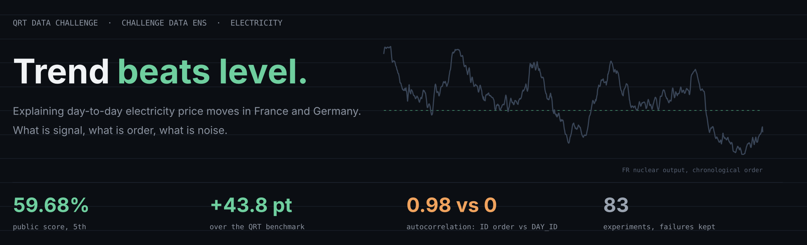
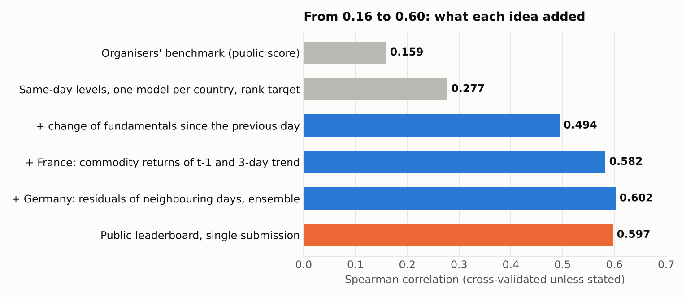
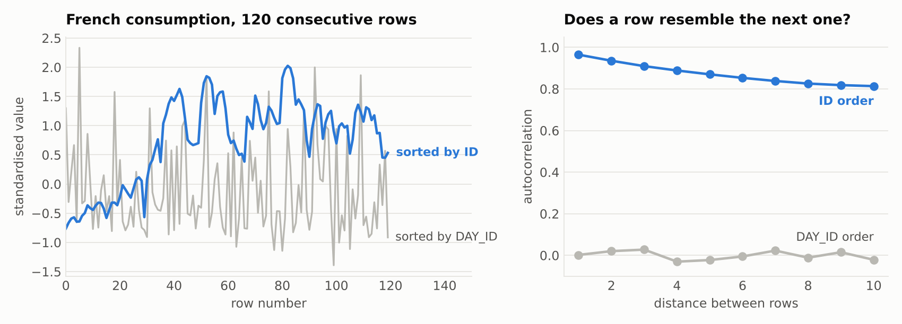
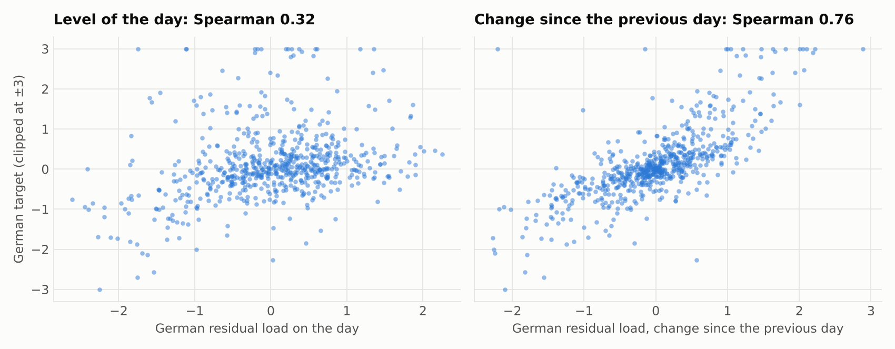
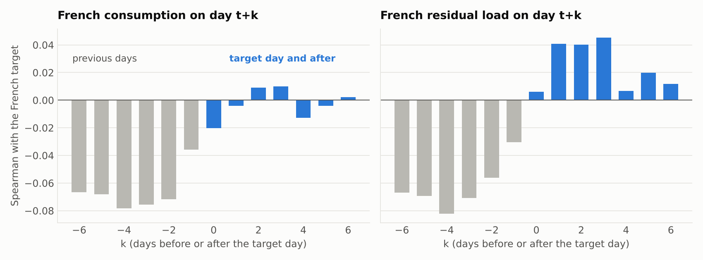
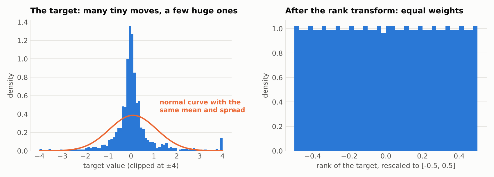
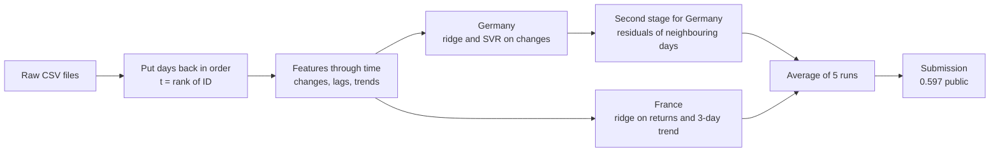
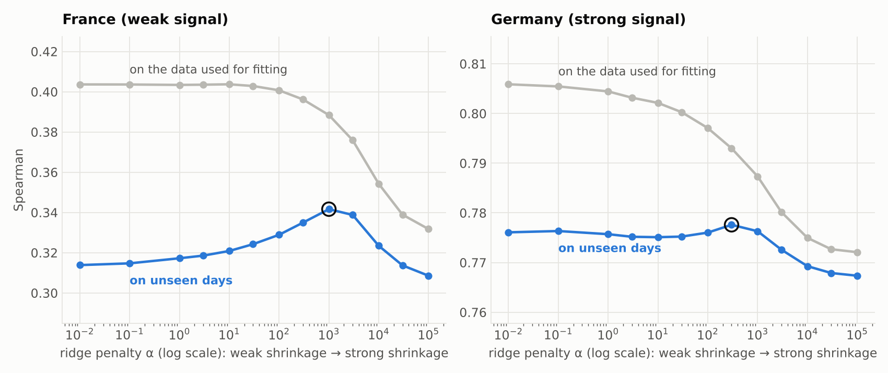
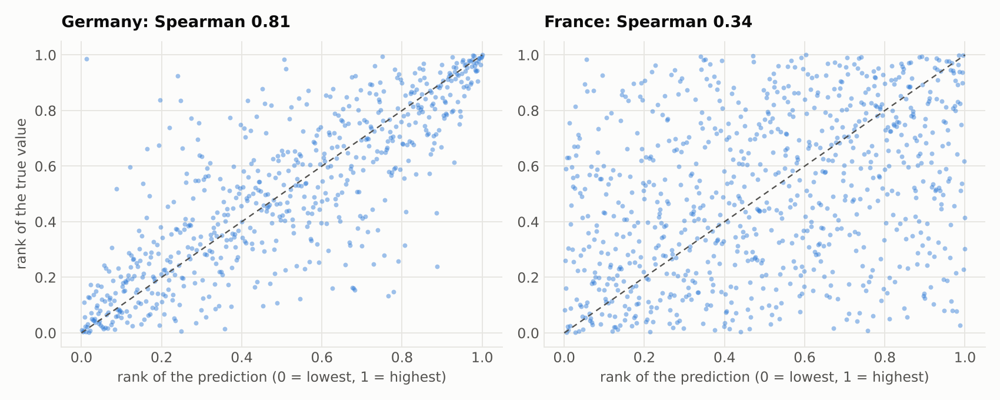
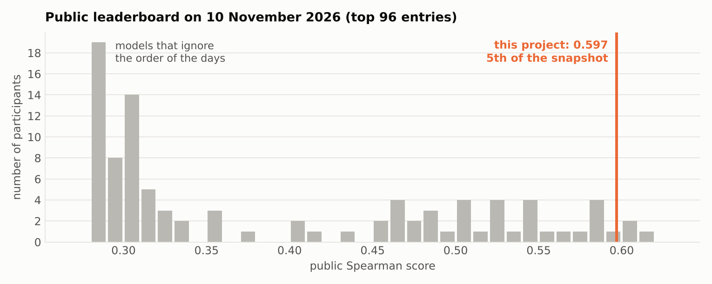

# Can you explain the price of electricity? ⚡

**QRT Data Challenge (Challenge Data, ENS / Collège de France). Public score 0.597, 5th on the leaderboard, with a single submission.**

The task: explain the daily price variation of electricity futures in France and Germany from weather, production, consumption and commodity data. The organisers' benchmark scores 0.159. This project reaches 0.60 in cross-validation and 0.597 on the public leaderboard.

This README is written so that you can follow it without a machine learning background. Every technical word is explained the first time it appears, and again in the [glossary](#glossary) at the end.



## The short version

| | |
|---|---|
| **Problem** | Rank 654 unseen (day, country) rows by price variation, as close as possible to the true ranking |
| **Metric** | Spearman correlation: 0 means a random ranking, 1 a perfect one |
| **Key finding** | The days were shuffled, but the `ID` column still carries their order in time. Once the days are back in order, the *change* of each variable from one day to the next becomes available, and that is what moves prices |
| **Model** | Small linear models (ridge), one per country, fitted on ranks. No deep learning, no heavy tuning |
| **Validation** | 5 x 5-fold cross-validation on days. Predicted 0.59 to 0.60 before submitting; the leaderboard returned 0.597 |
| **Result** | 5th of the public leaderboard on 10 November 2026, first and only submission |

## Table of contents

1. [The challenge in one minute](#1-the-challenge-in-one-minute)
2. [The finding that changed everything](#2-the-finding-that-changed-everything)
3. [What the data says](#3-what-the-data-says)
4. [The model, step by step](#4-the-model-step-by-step)
5. [Regularisation, or how not to fool yourself](#5-regularisation-or-how-not-to-fool-yourself)
6. [Validation: how do we know it is not luck?](#6-validation-how-do-we-know-it-is-not-luck)
7. [Results](#7-results)
8. [What did not work](#8-what-did-not-work)
9. [Limits and next steps](#9-limits-and-next-steps)
10. [Glossary](#glossary)
11. [Run it yourself](#run-it-yourself)

## 1. The challenge in one minute

Each row of the data is one day in one country (France or Germany). For each row we know 29 numbers describing that day:

| Family | Examples |
|---|---|
| Consumption | electricity consumed in each country |
| Production by source | nuclear, gas, coal, lignite, hydro, solar, wind |
| Residual load | consumption minus wind and solar: what conventional plants must cover |
| Exchanges | flows between the two countries and with the rest of Europe |
| Weather | temperature, rain, wind |
| Commodities | daily price variation of gas, coal and carbon allowances |

The quantity to explain is `TARGET`, the daily price variation of a short-maturity electricity futures contract.

There are 1,494 labelled rows to learn from and 654 rows to predict, spread over 1,216 days. That is a small dataset, and it shapes every choice below: with so few examples, a complicated model memorises noise instead of learning the mechanism.

**The metric.** Submissions are scored with the Spearman correlation. It ignores the exact values and only asks: did you put the rows in the right order? Formally, replace predictions $\hat y_i$ and true values $y_i$ by their ranks $R(\hat y_i)$ and $R(y_i)$, then compute the ordinary correlation of those ranks:

```math
\rho_s \;=\; \frac{\mathrm{cov}\big(R(\hat y),\,R(y)\big)}{\sigma_{R(\hat y)}\;\sigma_{R(y)}}
```

When there are no ties this is the same as $\rho_s = 1 - \dfrac{6\sum_i d_i^2}{n(n^2-1)}$, where $d_i$ is the difference between the two ranks of row $i$.

To give a feel for the scale: at 0.60, if you pick two rows at random, the model says correctly which one has the larger price variation about 70% of the time (50% would be a coin flip).

## 2. The finding that changed everything

The dataset comes with a day identifier, `DAY_ID`, that has been shuffled on purpose: day 12 and day 13 have nothing to do with each other. Most participants therefore treat every day as an isolated observation, and their scores cluster between 0.28 and 0.31.

A simple check tells a different story. If rows are in time order, a slow variable such as French consumption should look almost the same from one row to the next. So: sort the rows by each available column, and measure how much a row resembles the next one (this is called autocorrelation).



Sorted by `DAY_ID`, consecutive rows are unrelated (autocorrelation 0.00). Sorted by `ID`, the row identifier, they are nearly identical (0.97 for French consumption, 0.98 for French nuclear output). The `ID` column was assigned before the shuffle, and it kept the chronology.

Why this matters: the target is a price *variation*. A variation between yesterday and today can only be explained by what *changed* between yesterday and today. Without the order of the days, "yesterday" does not exist. With it, it does.

Two further facts from the audit, both important for the validation design:

- Test days are scattered at random among training days (527 switches between train and test along the timeline, 511 expected under pure chance).
- German rows only exist for the last 932 days. The first 284 days are France only.

Full audit: [`outputs/diagnostics/audit.md`](outputs/diagnostics/audit.md), regenerated by `python -m src.audit`.

## 3. What the data says

### Germany reacts to today's change

The single most informative variable for Germany is the residual load. Here it is twice against the German target: first as its level on the day, then as its change since the previous day.



Same variable, same days. The level explains little (0.32). The change explains most of it (0.76). The economic reading is direct: when wind drops or demand rises overnight, more expensive plants must run, and the price goes up that day.

### France looks ahead

France behaves differently. A one-day change explains almost nothing. What shows up instead is a pattern across several days: the French target is negatively related to what fundamentals were in the previous days, and slightly positively to what they will be in the coming days.



The French series behaves like a forward-looking contract that reprices on the *direction* in which the system is heading, plus the commodity returns (gas, carbon) of the day and of the day before. Each individual effect is small, which is why France stays the harder country.

### The target has extreme tails



Most days the price barely moves, and on a few days it moves enormously. A model fitted on raw values spends all its effort on those few days. Since the metric only looks at ranks anyway, the models here are trained on ranks: every day then counts the same.

## 4. The model, step by step



### Step 1: rebuild time

Each day gets a position $t \in \lbrace 0, \dots, 1215 \rbrace$, the rank of the `ID` of its French row. All variables become time series $x_{j,t}$ (variable $j$ on day $t$).

### Step 2: describe how things move

Three families of features, all computed from the explanatory variables only:

**Change since the previous day** (the German driver):

```math
\Delta x_{j,t} \;=\; x_{j,t} - x_{j,t-1}
```

**Lagged commodity returns** (France reacts to yesterday's gas and carbon moves too): $r_{j,t-1}$ alongside $r_{j,t}$.

**Three-day trend** (the French driver): the average of the three following days minus the average of the three previous days,

```math
T_{j,t} \;=\; \frac{1}{3}\sum_{k=1}^{3} x_{j,t+k} \;-\; \frac{1}{3}\sum_{k=1}^{3} x_{j,t-k}
```

Using the days after $t$ is legitimate here: the organisers describe the task as explaining prices with observed variables, not forecasting them, and those variables are provided for every day, test days included.

### Step 3: train on ranks

For each country separately, the target is replaced by its rank, rescaled to $[-0.5, 0.5]$:

```math
\tilde y_i \;=\; \frac{R(y_i) - 0.5}{n} - 0.5
```

Two reasons. The metric is rank-based, so this trains the model on what is actually scored. And it removes the influence of the extreme days.

One model per country, because the two countries respond to different things (changes for Germany, trends and commodities for France).

### Step 4: a deliberately simple model

The workhorse is **ridge regression**: a linear model, meaning the prediction is a weighted sum of the features,

```math
\hat y_i \;=\; \beta_0 + \sum_{j=1}^{p} \beta_j\, x_{ij}
```

where the weights $\beta$ are chosen to fit the data while staying small:

```math
\hat\beta \;=\; \arg\min_{\beta}\; \underbrace{\sum_{i=1}^{n}\big(\tilde y_i - x_i^\top\beta\big)^2}_{\text{fit the data}} \;+\; \underbrace{\alpha \sum_{j=1}^{p}\beta_j^2}_{\text{stay simple}}
\qquad\Longrightarrow\qquad
\hat\beta \;=\; \big(X^\top X + \alpha I\big)^{-1} X^\top \tilde y
```

The second term is the regularisation, explained in the next section. For Germany a second model family, support vector regression with a smooth kernel, is averaged in to capture mild curvature.

### Step 5: use what neighbouring days reveal (Germany)

After step 4, the German errors of consecutive days are negatively correlated (about $-0.36$): when the model is too low one day, it tends to be too high the next. That is what you expect if the price contains a temporary shock, which pushes one day's variation up and the next day's back down.

Because test days sit between training days, the error made on the training day just before and just after a test day is known. A small second model uses it:

```math
\hat y^{\,\text{final}}_t \;=\; \hat y_t \;+\; \gamma_1\, e_{t-1} \;+\; \gamma_2\, e_{t+1},
\qquad e_s = \tilde y_s - \hat y_s \ \text{ when day } s \text{ is a training day}
```

The errors $e_s$ are always computed by a model that did not see day $s$ (an inner cross-validation), so nothing leaks. This step adds about 0.03 for Germany and 0.01 overall. It is the one component that uses training targets of adjacent days as inputs; a version without it is provided (`K02`).

### Step 6: average

The final prediction is the average of five runs that differ slightly (ridge or SVR for Germany, one or two trend horizons for France). Each run is standardised first:

```math
\hat y^{\,\text{ens}}_i \;=\; \frac{1}{M}\sum_{m=1}^{M} \frac{\hat y^{(m)}_i - \mu_m}{\sigma_m}
```

Averaging does not look for the luckiest run; it removes part of the noise each run carries.

## 5. Regularisation, or how not to fool yourself

Give a flexible model few data points and it will explain them perfectly, including the parts that are pure chance. It then fails on new data. This is **overfitting**, and it is the main risk with 1,494 rows.

**Regularisation** is the remedy: penalise large weights so that the model only uses a feature if the evidence is strong. In ridge regression the strength of the penalty is $\alpha$:

- $\alpha \to 0$: ordinary least squares, every feature used at full strength, maximum risk of fitting noise;
- $\alpha \to \infty$: all weights shrink to zero, the model says nothing.

The right value sits in between and is found by measuring the score on days the model has not seen.



The grey curve is the score on the data used for fitting: it always looks best with no penalty. The blue curve is the score on unseen days: it peaks at an intermediate penalty. The gap between the two is the overfitting.

Two things worth noticing:

- France, where the signal is weak, needs a strong penalty ($\alpha \approx 1000$). Germany, where the signal is strong, hardly cares.
- The German curve is nearly flat between $\alpha = 0.01$ and $1000$ (0.775 to 0.778). When a result does not depend on a tuning knob, it is a good sign that it is real.

The other forms of regularisation used in this project follow the same logic: few features with an economic meaning rather than hundreds, linear models rather than deep trees, rank targets rather than raw values, an average of runs rather than the single best one.

## 6. Validation: how do we know it is not luck?

**Cross-validation.** The training days are split into 5 groups. The model is trained on 4 groups and scored on the fifth, 5 times in turn, so that every day is predicted by a model that never saw it. The whole procedure is repeated 5 times with different splits, 25 fits in total:

```math
\text{CV score} \;=\; \frac{1}{R}\sum_{r=1}^{R} \rho_s\Big(y,\; \hat y^{\,(-\text{fold}(i),\,r)}\Big)
```

Three design choices, each backed by a fact from the audit:

| Choice | Reason |
|---|---|
| Split by day, never by row | The French and German rows of a day share the same explanatory variables |
| Random days, not a block of "future" days | In the real test, test days are scattered among training days. A random split reproduces that; a chronological split would test a different problem |
| Contiguous time blocks as a second opinion | Checks that the result does not depend on one period: 0.56 with blocks, where the neighbour step cannot help by construction |

**How uncertain is the number?** A bootstrap (resampling days with replacement 1,000 times) gives a 90% interval of 0.55 to 0.65 for a sample the size of the test set.

**One known optimism, measured.** In 5-fold validation 80% of a day's neighbours are known, against 70% in the real test. Re-running with 67% known reduces the gain of the neighbour step from 0.0145 to 0.011. The expected test score was therefore stated as 0.59 to 0.60 before submitting.

**The verdict.** Public score: **0.5968**. Validation and reality agree, on the first submission, with no tuning against the leaderboard.



## 7. Results

| Stage | Pooled | France | Germany |
|---|---|---|---|
| Organisers' benchmark (public score) | 0.159 | | |
| Same-day levels, one ridge per country, rank target | 0.277 | 0.174 | 0.365 |
| Change since the previous day | 0.494 | 0.145 | 0.781 |
| France: lagged returns and 3-day trend | 0.582 | 0.342 | 0.781 |
| Germany: neighbouring residuals, 5-run ensemble | **0.602** | 0.348 | 0.816 |
| **Public leaderboard** | **0.597** | | |

Cross-validated Spearman unless stated. Every row of this table is an experiment stored in the repository with its configuration, fold-by-fold scores and predictions ([`experiments/experiment_results.csv`](experiments/experiment_results.csv), 83 experiments in total).



The leaderboard has two populations: a crowd around 0.30 and a smaller group above 0.50. The gap between them is the order of the days.

## 8. What did not work

Negative results are kept in the repository; they are part of the evidence.

| Idea | Outcome |
|---|---|
| Gradient boosting (LightGBM) for Germany | 0.762 to 0.785, against 0.781 for ridge: no gain for far more parameters |
| Gradient boosting, random forest, SVR for France | LightGBM on trend features 0.326 against 0.339 for ridge; forest 0.277 and SVR 0.274 against 0.284 for ridge on the earlier feature set |
| Separate French models before and after day 284 | 0.321 against 0.339 |
| Trend features for Germany | 0.798 against 0.808 |
| Levels on top of changes for Germany | 0.772 against 0.781 |
| More neighbours in the second stage (2, 3, 5 per side) | 0.807, 0.805, 0.803 against 0.808 with one |
| Rescaling French predictions against German ones | flat below 1, harmful above (x4: 0.490 pooled) |
| Weekly cycle (position modulo 5 or 7) | explains under 1% of anything: the timeline is ordinal, not a calendar |

The lesson is consistent: once the right features exist, the simplest model wins.

A first attempt made before the time axis was found is archived on the branch `claude/research`. It topped out at 0.31 after about a hundred experiments, which is itself a useful data point: no amount of modelling replaces a missing structural insight.

## 9. Limits and next steps

- **France is the weak leg**: 0.35 on 57% of the rows. This is where the remaining upside is.
- **The last 0.01 is within selection noise.** About 80 configurations were compared on the same folds. The large effects (changes, trends) are far beyond that noise; the choice among close variants is not.
- **The neighbour step uses training targets of adjacent days.** It is within the data provided, but a strict reading of "explain with simultaneous variables" could object to it. `K02` is the submission without it (0.588 in validation).
- **Not tested**: XGBoost and CatBoost.
- **Ideas for later**: a low-dimensional lead and lag kernel shared across variables for France; a state-space model of the German price level instead of the one-neighbour correction.

## Glossary

| Term | Meaning |
|---|---|
| **Autocorrelation** | How much a series resembles itself shifted by one or more steps. Close to 1: slow, smooth series. Close to 0: no memory |
| **Baseline / benchmark** | A simple reference model. If you cannot beat it, the fancy model is useless |
| **Bootstrap** | Estimating the uncertainty of a number by recomputing it many times on samples redrawn from the data |
| **Cross-validation (K-fold)** | Split the data in K parts, train on K-1, test on the last one, rotate. Every point is tested by a model that never saw it |
| **Ensemble** | Averaging several models. Errors that differ cancel out partly |
| **Feature** | An input of the model. "Feature engineering" is building better inputs from the raw ones |
| **Fat tails** | A distribution with far more extreme values than a normal curve |
| **Futures** | A contract to buy or sell at a fixed price for later delivery |
| **Lag / lead** | The value of a variable on a previous day (lag) or a following day (lead) |
| **Leakage** | Information reaching the model during training that it would not have in real use, which makes scores look better than they are |
| **Linear model** | A prediction built as a weighted sum of the inputs |
| **Out-of-fold prediction** | A prediction made for a row by a model trained without that row |
| **Overfitting** | Learning the noise of the training data: excellent on known data, poor on new data |
| **Rank transform** | Replacing each value by its position once sorted |
| **Regularisation** | A penalty that keeps a model simple, to limit overfitting |
| **Residual** | The error of a model on one row: true value minus prediction |
| **Residual load** | Consumption minus wind and solar production: what conventional plants have to supply |
| **Ridge regression** | A linear model with a penalty on the squared size of its weights |
| **Spearman correlation** | Correlation computed on ranks: measures whether two rankings agree |
| **SVR** | Support vector regression: a model that can bend slightly where a straight line is not enough |
| **Target** | The quantity to predict |
| **Train / test** | Data used to fit the model / data kept aside to judge it |

## Run it yourself

```bash
pip install -r requirements.txt          # Python 3.10+
python -m src.audit                      # data audit        -> outputs/diagnostics/audit.md
python main.py run --all                 # all 83 experiments -> experiments/experiment_results.csv
python main.py submit K01_ensemble_main  # submission file    -> outputs/submission_K01_ensemble_main.csv
python -m src.robustness                 # bootstrap and neighbour-availability checks
python -m docs.make_figures              # figures of this page
```

Everything is deterministic: a clean clone reproduces the 83 scores and the submission file exactly.

| Path | Content |
|---|---|
| `src/data.py` | loading, time axis from `ID` |
| `src/features.py` | feature blocks: levels, changes, lags, leads, trends |
| `src/models.py` | models and target transforms |
| `src/validation.py` | the two validation schemes |
| `src/experiment.py` | experiment runner, neighbour-residual stage, ensembling |
| `src/registry.py` | every experiment, with its hypothesis, successful or not |
| `experiments/RESEARCH_LOG.md` | the research diary: hypotheses, results, conclusions |
| `outputs/` | predictions, diagnostics, submissions |
